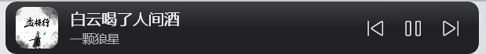

# 网易云迷你播放器 · Xbox Game Bar Widget

> A taskbar-height Xbox Game Bar strip that controls NetEase Cloud Music through Windows SMTC.
>
> 一条贴任务栏高度的 Game Bar 小组件，用 Windows SMTC 读取并控制网易云音乐。



> 实机截图：左侧封面，中间歌名与歌手，右侧上一首 / 播放暂停 / 下一首。

## 安装

### 方式一：一键安装包（推荐）

1. 解压 `NeteaseGameBarWidget-<版本>-x64.zip` —— 整包解压，不要只把 `.msix` 拖出来。
2. 双击 `install.cmd`。
3. 弹出用户账户控制时点「是」。这一步把签名证书装进本机受信任存储，是旁加载应用的固定要求。
4. 看到「安装完成」后，启动网易云音乐播放歌曲，按 `Win+G` → 小组件菜单 → 添加「网易云迷你播放器」→ 点标题栏图钉固定。

安装脚本会先补装 `Dependencies` 下的框架包，再装主包；已装旧版会自动替换，不需要手动卸载。

### 方式二：从源码构建

需要 Visual Studio（含 UWP / WinUI 工作负载）与 Windows 11 SDK，仓库根目录的 `.vsconfig` 可直接导入。

```powershell
.\tools\Build.ps1 -Configuration Debug -Platform x64
.\tools\Install-Dev.ps1
```

打包成可分发的安装包（自签名 MSIX + 安装脚本 + 依赖框架）：

```powershell
.\tools\make-release.cmd
```

产物在 `dist\` 下，直接发 `.zip` 即可。

### 卸载

```powershell
.\tools\uninstall.cmd
```

或 设置 → 应用 → 已安装的应用 → 网易云迷你播放器 → 卸载。

## 调整高度

小组件的高度锁定为任务栏高度：Windows 11 按 48 DIP、Windows 10 按 40 DIP 估算；宽度可自由拖动（300–600），拖宽只会让歌名多显示几个字，字号不变。

如果高度对不上（开了「小任务栏按钮」或换了第三方外壳），在安装目录运行：

```powershell
.\set-taskbar-height.cmd 32        # 指定高度，单位 DIP，范围 24–96
.\set-taskbar-height.cmd -Reset     # 恢复自动检测
```

改完重启小组件生效。设置写在 `LocalState\settings.json`，非法值会被忽略回落到自动值。

## 常见问题

### 小组件菜单里没有「网易云迷你播放器」

- 完全退出 `GameBar.exe`（任务管理器）后重新打开 Game Bar。
- 确认安装成功：`Get-AppxPackage -Name NeteaseGameBarWidget`。

### 安装报 0x800B0109

证书没进本机受信任存储。右键 `install.cmd` → 以管理员身份运行。

### 安装报 0x80073CF3

缺依赖框架。用整包里的 `install.cmd`（会先装 `Dependencies` 下的框架），不要单独双击 `.msix`。

### 显示「无法读取网易云」

- 确认网易云正在播放，系统音量控制中心能看到这首歌。
- 清单已声明 `globalMediaControl`；若仍失败，先 `Win+G` 打开再关掉 Game Bar，重新添加小组件。

## 已知限制

- 不显示歌词和进度条：SMTC 只提供标题、歌手、专辑和封面，没有逐句时间轴。
- 高度是估算值，非标准任务栏需要用 `set-taskbar-height.cmd` 覆盖。
- `globalMediaControl` 属受限能力，自签名旁加载在部分系统上可能部署成功但运行时拒绝访问。
- 只匹配 AUMID 中含 `cloudmusic` 的会话；网易云改进程名时需调整 `SmtcService.IsNetease`。
- 发布包用 CoreCLR 构建（关闭 .NET Native）以避开 2.3.60521 框架依赖，体积略大、启动略慢。
- 目前只提供 x64 包。

## 参考

- [Xbox Game Bar SDK 入门](https://learn.microsoft.com/en-us/xbox/game-bar/quickstart/introduction)
- [官方示例](https://github.com/microsoft/XboxGameBarSamples)
- [Microsoft.Gaming.XboxGameBar NuGet](https://www.nuget.org/packages/Microsoft.Gaming.XboxGameBar)
- [SMTC API](https://learn.microsoft.com/en-us/uwp/api/windows.media.control.globalsystemmediatransportcontrolssessionmanager)

## 说明

本项目是个人开发的小工具，与网易云音乐、Microsoft、Xbox 没有隶属关系。网易云音乐和 Xbox Game Bar 的商标归各自所有者所有。

## License

[MIT](LICENSE)
